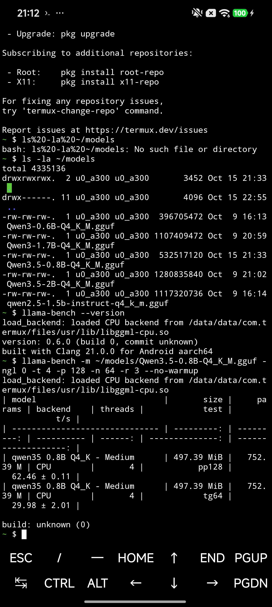
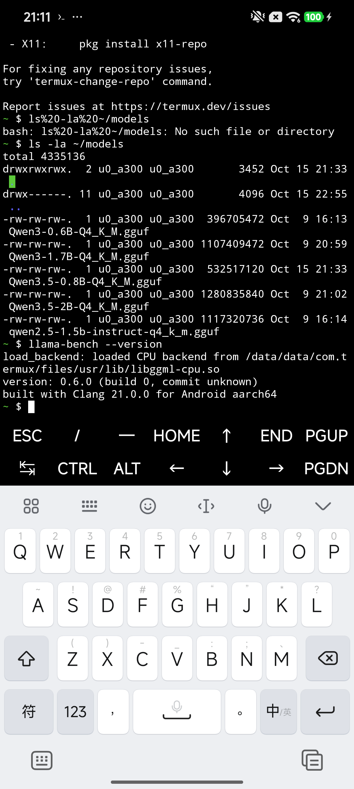

# MNN 推理引擎手机部署实测 · Redmi K70E

实测日期：2026-10-19

文档类型：端侧部署实测报告

文档状态：已完成 CPU 部署、端到端生成、线程矩阵、长上下文扫描和同机 llama.cpp 对照；持续热负载和 OpenCL/NPU 仍待验证。

## 结论摘要

```text
已验证结论
  引擎        MNN 3.6.1，Android arm64，CPU-only 自编译
  设备        Redmi K70E，MediaTek MT6897，Android 16，12 GB RAM
  模型        Qwen3.5-0.8B-MNN，4-bit，quant block 64
  能力        中文端到端生成成功，26 prompt token / 18 decode token
  基准        t4 时 pp128 200.98 t/s，tg64 47.97 t/s
  同机对照    llama.cpp CPU 62.46 / 29.98 t/s
  核心判断    MNN 在这台机器上优势明显，但热状态会显著改变绝对速度
```

## 报告信息与证据等级

| 结论 | 直接证据 | 等级 |
|---|---|---|
| MNN 3.6.1 可在 K70E 上完成 CPU 推理 | `llm_demo` 中文生成成功，进程正常退出 | 已验证 |
| MNN t4 短时吞吐为 pp128 200.98、tg64 47.97 t/s | `mnn-t4-r3.json`，3 次重复 | 已验证 |
| MNN 比同机 llama.cpp 更快 | 同一设备、同一基座、同一 4 线程设置 | 已验证，量化格式不完全相同 |
| 4 线程优于 6/8 线程 | 三组线程矩阵结果方向一致 | 已验证 |
| 4096 token 下仍能保持约 45 t/s decode | `mnn-d4096-r2.json` | 已验证 |
| 长时聊天能稳定保持峰值 | 未做 10~30 分钟持续负载 | 待确认 |
| OpenCL/Vulkan 是否可用 | 本次构建显式关闭 OpenCL/Vulkan | 未执行 |

## 一、部署路径

这次先尝试官方 MNN Chat APK，再走可脚本化的 CLI 路线。APK 下载和校验正常，安装被 HyperOS 拦下：

```text
MNN Chat 0.8.3 APK
  41,834,292 bytes
  SHA-256 EB249CABBF73B8B1567D7611715CAD8F1CBF4DF7BE75CB447EA206F12F94AB14
        │
        ├─ adb install -r
        │    └─ INSTALL_FAILED_USER_RESTRICTED
        └─ pm install -r --user 0
             └─ INSTALL_FAILED_USER_RESTRICTED

判定：HyperOS 的 USB 安装授权拦截，不能据此判定 MNN 运行时不兼容。
```

因此本次实际可运行路径是：

```text
MNN 3.6.1 源码
        │
        ├─ Android NDK r28b
        ├─ CMake + Ninja
        └─ arm64-v8a，c++_static，MNN_BUILD_LLM=ON
                │
                ├─ llm_bench
                └─ llm_demo
                        │
                        ▼
              /data/local/tmp/mnn/
                ├─ bin/llm_bench
                ├─ bin/llm_demo
                └─ models/Qwen3.5-0.8B-MNN/
                        │
                        ├─ llm.mnn
                        ├─ llm.mnn.weight
                        ├─ tokenizer.txt
                        ├─ visual.mnn
                        └─ 其余配置
```

`llm_bench` 只依赖 Android 系统库 `liblog.so`、`libm.so`、`libandroid.so`、`libdl.so`、`libc.so`，没有 Termux 的 libc++ 依赖。

## 二、环境和模型身份

| 项目 | 值 |
|---|---|
| 手机 | Redmi K70E，型号 2311DRK48C，代号 duchamp |
| SoC | MediaTek MT6897，天玑 8300-Ultra |
| 系统 | Android 16，SDK 36，HyperOS OS3.0.305.0.WNLCNXM |
| 内存 | 12 GB |
| 推理后端 | CPU，ARM82，i8mm，SVE2，Flash Attention 开启 |
| MNN 版本 | 3.6.1 |
| NDK | r28b，28.1.13356709 |
| 模型 | Qwen3.5-0.8B-MNN |
| 量化 | `quant_bit=4`，`quant_block=64`，`lm_quant_bit=4` |
| 模型目录总大小 | 547,645,527 bytes |
| LLM 权重 | 470,382,614 bytes，SHA-256 `4E25EF4CBFB49A33013D17300C2F68CD9C9CE8F2E3F7B947FD2C574EC297CA5E` |

手机上模型目录为：

```text
/data/local/tmp/mnn/models/Qwen3.5-0.8B-MNN/
/data/local/tmp/mnn/bin/llm_bench
/data/local/tmp/mnn/bin/llm_demo
/data/local/tmp/mnn/results/
```

电脑上的模型、源码、NDK、构建产物和原始 JSON 都在：

```text
research/mnn-20261019/
  model/Qwen3.5-0.8B-MNN/
  src/MNN-3.6.1.zip
  toolchain/android-ndk-r28b-windows.zip
  build/llm_bench
  build/llm_demo
  device-results/
```

### 实验口径

```text
供电       交流电，电量 100%，无风扇
连接       USB ADB，屏幕是否点亮不作为测量变量
MNN        -a cpu -t 4 -p 128 -n 64 -rep 3 -load true
MNN 深度   -load false，只比较 prefill/decode
llama.cpp  -ngl 0 -t 4 -p 128 -n 64 -r 3 --no-warmup
重复顺序   MNN 先测，随后 llama.cpp，再补 MNN 热状态复测
```

本轮没有做严格的 ABBA 交叉顺序。MNN 和 llama.cpp 的第一组对照间隔较短，但两者的峰值结果仍受预热、主频和系统调频影响；报告同时保留热状态复测和短停恢复结果，避免只截取最高值。

## 三、端到端生成

固定中文提示词：

```text
只用一句中文回答：MNN 推理引擎的主要用途是什么？
```

实际输出：

```text
它主要用于处理大规模神经网络模型的批处理、加速训练和实现复杂的机器学习任务。
```

运行统计：

```text
prompt tokens  26
decode tokens  18
prefill        0.14 s，187.34 tok/s
decode         0.39 s，45.70 tok/s
```

这说明 tokenizer、聊天模板、权重加载和生成链路都已跑通。该回答在语义上不完整，把“端侧推理”说成了“批处理、训练”，因此这次验证的是部署和吞吐，不是模型能力评测。

## 四、MNN 基准结果

测量命令：

```bash
llm_bench -m ./models/Qwen3.5-0.8B-MNN/config.json \
  -a cpu -t 4 -p 128 -n 64 -rep 3 -load true \
  -j ./results/mnn-t4-r3.json
```

线程矩阵：

| 线程 | pp128 t/s | tg64 t/s | 加载时间 s |
|---:|---:|---:|---:|
| 4 | 200.98 ± 0.31 | 47.97 ± 0.89 | 0.99 ± 0.06 |
| 6 | 135.72 ± 5.83 | 26.33 ± 0.48 | 1.00 ± 0.06 |
| 8 | 128.39 ± 2.97 | 26.86 ± 0.07 | 0.98 ± 0.06 |

4 线程明显最优。6 线程和 8 线程把任务迁到小核簇，prefill 和 decode 同时下降，和这台机器原来的三簇 CPU 结构一致。

提示长度的扫描结果：

| 提示长度 | prefill t/s | 后续 tg64 t/s |
|---:|---:|---:|
| 0 | 不适用 | 49.78 ± 0.29 |
| 512 | 206.61 ± 2.37 | 48.26 ± 0.41 |
| 2048 | 194.76 ± 0.09 | 44.42 ± 0.06 |
| 4096 | 165.72 ± 0.71 | 45.58 ± 1.35 |

4096 token 时 prefill 仍保持 165.72 t/s，decode 仍有 45.58 t/s。长上下文测试组使用 `-load false`，不计入加载时间。

### 原始 JSON 对照

| 文件 | 线程 | 提示长度 | prefill t/s | decode t/s | 说明 |
|---|---:|---:|---:|---:|---|
| `mnn-smoke.json` | 4 | 128 | 196.73 | 43.74 | 首次冒烟 |
| `mnn-t4-r3.json` | 4 | 128 | 200.98 | 47.97 | 主结果 |
| `mnn-t6-r3.json` | 6 | 128 | 135.72 | 26.33 | 线程扩展失败 |
| `mnn-t8-r3.json` | 8 | 128 | 128.39 | 26.86 | 线程扩展失败 |
| `mnn-d0-r2.json` | 4 | 0 | — | 49.78 | 纯 decode |
| `mnn-d512-r2.json` | 4 | 512 | 206.61 | 48.26 | 中等上下文 |
| `mnn-d2048-r2.json` | 4 | 2048 | 194.76 | 44.42 | 长上下文 |
| `mnn-d4096-r2.json` | 4 | 4096 | 165.72 | 45.58 | 更长上下文 |
| `mnn-t4-r3-postllama.json` | 4 | 128 | 81.65 | 16.63 | 高热状态复测 |
| `mnn-t4-r1.json` | 4 | 128 | 194.02 | 44.80 | 短停后复测 |

## 五、同机 llama.cpp 对照

同一台手机、同一基座模型、同为 4 线程纯 CPU：

| 项目 | MNN 3.6.1 | llama.cpp 0.6.0 |
|---|---:|---:|
| 模型 | Qwen3.5-0.8B-MNN | Qwen3.5-0.8B-Q4_K_M |
| 运行时大小 | 448.59 MiB | 497.39 MiB |
| pp128 t/s | **200.98** | 62.46 |
| tg64 t/s | **47.97** | 29.98 |
| 相对速度 | prefill 3.22×，decode 1.60× | 基准 |

llama.cpp 命令：

```bash
llama-bench -m ~/models/Qwen3.5-0.8B-Q4_K_M.gguf \
  -ngl 0 -t 4 -p 128 -n 64 -r 3 --no-warmup
```

两者都是 4-bit 附近的量化，但格式和量化实现不同：

```text
MNN       4-bit weight，block 64，lm_head 4-bit，官方 MNN 导出
llama.cpp Q4_K_M，GGUF，Termux 0.6.0 包
```

因此上表适合回答“同一台手机、同一基座下哪条路径更快”，不能当作“完全相同权重、完全相同量化算法”的严格算子公平测试。

## 六、热状态与稳定性

第一轮 MNN t4 测量时，电池温度约 28.2°C，得到 200.98 / 47.97 t/s。随后连续跑了 4096 长提示和 llama.cpp 对照，手机电池温度升到 32.6°C，CPU4 当前频率从 2.4 GHz 降到 1.6 GHz，CPU7 只有 400 MHz。此时 MNN 复测出现：

```text
pp128  81.65 t/s
tg64   16.63 t/s
```

短时间停顿后再次复测，MNN 恢复到：

```text
pp128  194.02 t/s
tg64   44.80 t/s
```

这组现象说明了两个事实：

```text
已验证
  MNN 本身可以在这台手机上达到约 200 / 48 t/s。

仍待确认
  这组数字能不能在连续聊天或长上下文服务中稳定保持。
  当前只做了短时爆发和一次热状态复测，没有做 10~30 分钟持续负载。
```

因此建议把 200 / 48 t/s 记为“短时峰值”，把 45 t/s 左右的 decode 记为“当前轻度负载下的常见区间”，不要把峰值写进产品承诺。

### 截图证据

llama.cpp 同机基准截图，包含版本、模型大小、pp128 和 tg64：



Termux 运行时版本截图：



MNN 的原始基准数据以 JSON 归档为准，路径为 `research/mnn-20261019/device-results/`；截图只用于证明 llama.cpp 对照确实在同一台手机上执行。

## 七、APK 路线与后续

如果要在手机上直接使用 MNN Chat 图形界面，需要先在 HyperOS 开发者选项里打开并授权 USB 安装，然后执行：

```powershell
tools\platform-tools\adb.exe install -r research\mnn-20261019\mnn_chat_0_8_3.apk
```

这次安装失败没有改动系统设置，也没有绕过安全限制。CLI 路线已经足够验证 MNN 引擎，APK 只是另一种交互层。

下一步值得做的工作：

```text
1. 打开 HyperOS USB 安装授权，安装 MNN Chat，比较 App 与 CLI benchmark 的口径。
2. 做 10 分钟以上持续负载，记录温度、频率、t/s 曲线，判断日常聊天是否掉速。
3. 单独编译 OpenCL 后端，确认 Mali-G615 是否真的被 MNN 枚举。
4. 给 llm_demo 外面套 HTTP 服务，和现有 llama-server 的 OpenAI 兼容接口对齐。
5. 用同一份原始 FP16 权重分别导出 MNN 和 GGUF，再做一次严格量化对照。
```

## 八、复现入口

一键脚本：

```powershell
powershell -ExecutionPolicy Bypass -File tools\deploy-mnn-bench.ps1 `
  -Threads 4,6,8 -Repeats 3 -RunDemo
```

脚本说明见 [tools/deploy-mnn-bench.doc.md](tools/deploy-mnn-bench.doc.md)，原始结果和文件清单见 [research/mnn-20261019/README.md](research/mnn-20261019/README.md)。

### 交付物

| 文件 | 内容 |
|---|---|
| `MNN部署实测报告.md` | 本文，结论、数据、限制和复现入口 |
| `tools/deploy-mnn-bench.ps1` | 下载、编译、推送、基准和生成脚本 |
| `tools/deploy-mnn-bench.doc.md` | 脚本的输入输出、流程和失败处理 |
| `research/mnn-20261019/README.md` | 模型、配置、原始结果和文件清单 |
| `research/mnn-20261019/device-results/` | 10 份 MNN `llm_bench` JSON |
| `research/mnn-20261019/termux-bench2.png` | llama.cpp 同机对照截图 |
| `research/mnn-20261019/mnn_chat_0_8_3.apk` | 官方 APK，安装受 HyperOS 限制 |

### 本次验证清单

| 检查项 | 结果 |
|---|---|
| ADB 能枚举 K70E | 通过 |
| MNN 3.6.1 源码由 NDK r28b 编译 | 通过 |
| `llm_bench` 在手机上执行 | 通过 |
| `llm_demo` 中文端到端生成 | 通过 |
| 手机端 `llm.mnn.weight` 哈希 | 通过，与电脑端一致 |
| MNN JSON 结果能解析 | 通过 |
| 同机 llama.cpp 对照 | 通过，版本 0.6.0 |
| MNN Chat APK 安装 | 失败，`INSTALL_FAILED_USER_RESTRICTED` |
| 10 分钟以上持续热负载 | 未执行 |
| OpenCL / NPU | 未执行 |

### 结论边界

```text
可以作为结论
  MNN 在 K70E 的 CPU 路径上可部署、可生成。
  t4 的短时性能显著高于同机 llama.cpp。
  4 线程是当前模型的最优线程数。

只能作为推断
  MNN 更适合作为这台手机的常驻推理引擎，前提是后续持续负载不掉到不可接受的水平。

不能直接承诺
  所有安卓机都能得到相同倍率。
  OpenCL/NPU 会自动更快。
  长时间聊天始终维持 47 t/s。
```
